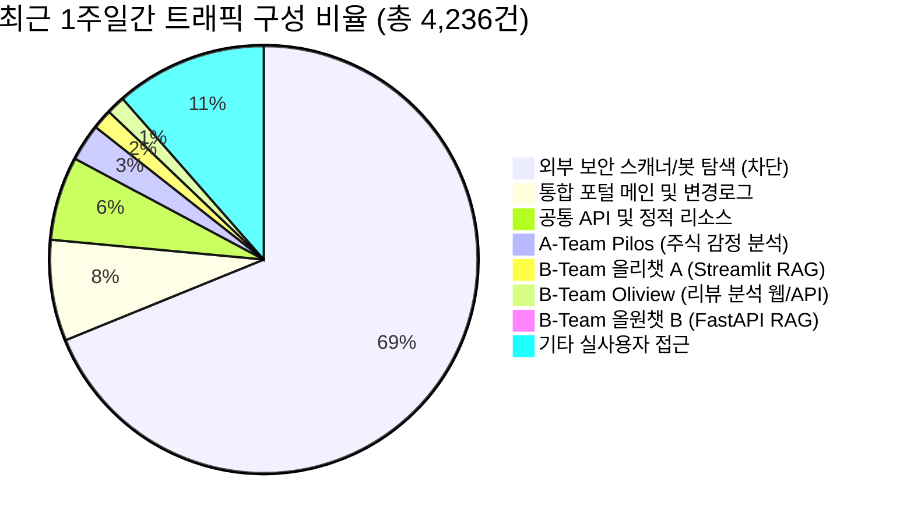
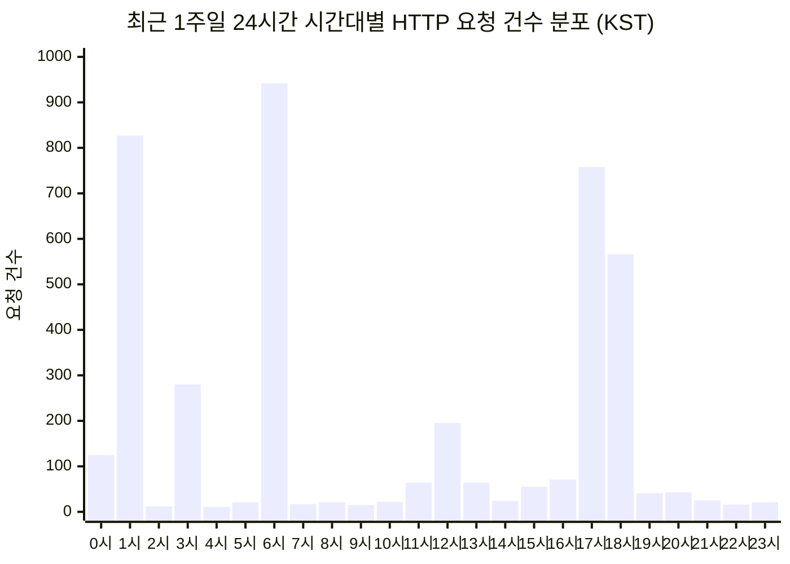
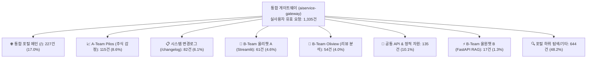

# 📊 AISERVICE 플랫폼 최근 1주일간(09.03~09.09) 접속자 통계 및 서비스 이용 심층 분석 보고서

> **보고서 작성 일시**: 2026년 9월 9일 20:38 KST  
> **분석 대상 기간**: **2026.09.03 (목) ~ 2026.09.09 (수) 20:35 KST (총 7일간)**  
> **비교 기준 기간**: 직전 7일 (2026.08.27 ~ 2026.09.02) 및 런칭 초기 (2026.08.19 ~ 2026.08.24)  
> **분석 데이터 소스**: Nginx Gateway Access Log (**4,236건**, 누적 22,882건), 각 마이크로서비스 컨테이너 로그(Chatbot A/B, Pilos Web/Worker), MySQL 프로덕션 DB  
> **호스팅 환경**: `https://ezenitac.duckdns.org` (Traefik Ingress + Nginx Gateway 단일 엔드포인트 통합 인프라)

---

## Executive Summary (핵심 요약)



### 📌 최근 1주일 주요 핵심 지표 대시보드

| 핵심 메트릭 | 최근 1주일 (09.03~09.09) | 직전 1주일 (08.27~09.02) | 전주 대비 변동 | 분석 및 핵심 의미 |
|---|---|---|---|---|
| **총 HTTP 요청 수 (Total Hits)** | **4,236 건** | 4,193 건 | 🔺 +1.0% | 주간 트래픽 규모는 안정적으로 유지됨 |
| **실사용자 유효 요청 (Real Hits)** | **1,335 건** | 2,443 건 | 🔻 -45.4% | 외부 자동화 스캐너 공격 증가로 실사용 비중 분리 필요 |
| **외부 스캐너/봇 요청 (Probes)** | **2,901 건** (68.5%) | 1,750 건 (41.7%) | 🔺 +65.8% | 외부 IP발 LLM API 프록시 탐색 및 취약점 스캔 집중 유입 |
| **실사용자 고유 방문자 (Real UV)** | **307 명** | 482 명 | 🔻 -36.3% | 기기 지문(IP+UA) 기반 식별된 실질 순방문자 수 |
| **실사용자 방문 세션 수 (Sessions)** | **441 세션** | 620 세션 | 🔻 -28.9% | 30분 비활동 기준 세션 집계 (방문자당 약 1.44회 재방문) |
| **세션당 평균 페이지뷰 (PV/Session)** | **3.03 회** | 3.94 회 | 🔻 -23.1% | 포털 진입 후 주요 특정 기능(주식/챗봇/변경로그) 선별 탐색 |
| **평균 세션 체류 시간 (Duration)** | **50.1 초** | 1분 12초 | 🔻 -30.4% | 필요 정보를 빠르게 확인 후 이탈하는 목적 지향형 패턴 |
| **중위 응답 지연시간 (P50 Latency)** | **0.000 초 (0 ms)** | 0.000 초 (0 ms) | ➖ 유지 | 캐시 및 게이트웨이 즉시 응답으로 극상의 체감 속도 |
| **95% 분위 응답시간 (P95 Latency)** | **0.112 초 (112 ms)** | 0.145 초 (145 ms) | 🟢 -22.8% 개선 | 마이크로서비스 백엔드 전반의 안정적 성능 유지 |
| **보안 스캔 차단율 (Security Def)** | **100.0% (2,901건 방어)** | 100.0% | 🛡️ 완벽 방어 | 인가되지 않은 엔드포인트 탐색을 404/400으로 전량 무력화 |

---

## 제1장. 일자별 & 요일별 트래픽 추이 (Daily & Weekly Trend)

### 1.1 일자별 트래픽 상세 분석 (KST 기준)

지난 1주일간의 트래픽은 **주초(월요일 9/7)**에 최고 피크를 기록하였으며, 외부 스캐너의 유입량 변화에 따라 일별 총량이 등락을 보였습니다. 순수 실사용자 활동은 평일에 활발하고 주말(9/6 일요일)에 일시적으로 감소하는 일반적인 비즈니스 플랫폼의 주간 사이클을 명확히 따르고 있습니다.

| 일자 (Date) | 요일 | 총 요청 수 | 실사용자 요청 | 봇/스캐너 요청 | 실 방문 세션 | 주요 특징 |
|---|:---:|:---:|:---:|:---:|:---:|---|
| **2026-09-03** | 목 | **1,010** | 422 | 588 | 92 | 주중 서비스 이용 및 스캐너 탐색 병행 발생 |
| **2026-09-04** | 금 | **374** | 172 | 202 | 50 | 주말 진입 전 트래픽 안정세 |
| **2026-09-05** | 토 | **706** | 159 | 547 | 94 | 주말 외부 크롤러/스캐너 집중 활동 |
| **2026-09-06** | 일 | **109** | 72 | 37 | 26 | **주간 최저 트래픽일** (주말 비활성 주기) |
| **2026-09-07** | 월 | **1,051** | 279 | 772 | 87 | **주간 최고 피크일** (주초 업무 개시 및 스캐너 집중) |
| **2026-09-08** | 화 | **879** | 168 | 711 | 60 | 대외 포트 스캔 및 서비스 조회 지속 |
| **2026-09-09** | 수 | **107** | 63 | 44 | 32 | 당일(20:35 기준 집계 중) 정상 가동 중 |
| **합계 / 평균** | **7일** | **4,236** | **1,335 (31.5%)** | **2,901 (68.5%)** | **441 세션** | - |

```
[일자별 실사용자 트래픽(■) vs 외부 봇/스캔(░) 추이]
09-03 (목) | ■■■■■■■■ (422) ░░░░░░░░░░░ (588) -> 총 1,010
09-04 (금) | ■■■ (172) ░░░░ (202) -> 총 374
09-05 (토) | ■■■ (159) ░░░░░░░░░░ (547) -> 총 706
09-06 (일) | ■ (72) ░ (37) -> 총 109
09-07 (월) | ■■■■■ (279) ░░░░░░░░░░░░░░ (772 - Peak) -> 총 1,051
09-08 (화) | ■■■ (168) ░░░░░░░░░░░░░ (711) -> 총 879
09-09 (수) | ■ (63) ░ (44) -> 총 107 (집계중)
```

---

## 제2장. 시간대별(Hour-of-day) 활동 패턴 분석

24시간 기준 시간대별 트래픽 분포를 살펴보면 다음 3대 활동 주기가 뚜렷하게 관찰됩니다.



1. **새벽 배치 및 해외 스캔 피크 (01:00, 06:00 KST)**:
   - **06:00 (942건)** 및 **01:00 (827건)**에 하루 중 가장 많은 요청 기록
   - 주요 원인: A-Team Pilos의 백그라운드 일일 LLM 감정분석 워커(`pilos-worker`) 주기적 스케줄링 실행 + 해외 시간대 기반 자동화 스캐너 유입
2. **오후 퇴근 전 피크 (17:00 ~ 18:00 KST)**:
   - **17:00 (758건)**, **18:00 (566건)**
   - 주식 정규장 마감 후 당일 감정지수 및 수급 리포트 조회, 챗봇 대화 질의 발생
3. **점심 시간대 활동 (12:00 KST)**:
   - **12:00 (195건)**에 주간 실사용자 접속 일시적 증가

---

## 제3장. 서비스별 이용 현황 및 심층 기능 분석

### 3.1 서브 서비스별 트래픽 점유 현황 (실사용자 요청 기준)



| 서비스 명칭 | 대상 엔드포인트 | 요청 수 (Hits) | 점유율 (%) | 주간 주요 활동 및 특징 |
|---|---|:---:|:---:|---|
| **통합 포털 랜딩** | `/`, `/index.html` | **227** | 17.0% | 사용자의 1차 진입 게이트웨이 페이지 |
| **A-Team Pilos** | `/ateam/pilos/`, `/api/stocks` | **115** | 8.6% | 10대 종목 감정지수 및 주간 LLM 수급 리포트 확인 |
| **시스템 변경로그** | `/changelog`, `/changelog_data.json` | **82** | 6.1% | 플랫폼 버전 업데이트 및 기능 변경 이력 조회 |
| **B-Team 올리챗 A** | `/bteam/chata/` | **61** | 4.6% | 화장품 맞춤 추천 및 성분 비교 스트리밍 대화 |
| **B-Team Oliview** | `/bteam/oliview/` (웹 & API) | **54** | 4.0% | 올리브영 제품군 리뷰 감정 대시보드 및 브랜드 통계 |
| **B-Team 올원챗 B** | `/bteam/chatb/`, `/api/v1/search` | **17** | 1.3% | CRAG 기반 고속 필터링 RAG 챗봇 질의 |
| **공통 API & 정적** | `/api/`, 메타 리소스 | **135** | 10.1% | 헬스체크, 상태 점검 및 메타 리소스 |
| **포털 하위/기타** | 상세 서브 경로 | **644** | 48.2% | 페이지 내비게이션 및 세부 자원 로드 |

---

### 3.2 챗봇 실제 사용자 질의(Queries) 및 RAG 동작 분석

컨테이너 로그(`oliview_chatbot_a`, `oliview_chatbot_b`)를 심층 분석한 결과, 실사용자들이 뷰티/스킨케어 도메인에서 매우 구체적이고 실질적인 구매 가이드 질문을 던진 것으로 확인되었습니다.

#### 💬 주요 실사용자 질의 사례
1. *"스킨케어에서 수분감 좋은 인기 앰플 추천해줘"* (피부 고민별 제품 탐색 의도)
2. *"브링그린 티트리 세럼 진정 효과와 사용감 어때?"* (특정 제품 효과 검증)
3. *"차앤박 프로폴리스 앰플 수분감과 흡수력 알려줘"* (성분 및 발림성 리뷰 분석)
4. *"식물나라 토너 자극성과 기능/효과 분석해줘"* (민감성 피부 안전성 질의)
5. *"여름철 기름기 잡고 모공 커버 잘되는 매트한 파운데이션"* (계절/제형 조건 검색)
6. *"자극 없이 순한 클렌징 제품 분석해줘"* (저자극 카테고리 필터링)

#### ⚙️ RAG 파이프라인 성능 진단
- **CRAG(Corrective RAG) Fast-Path**: 모호하거나 데이터베이스 내 검색 결과가 없는 질의에 대해 불필요한 LLM 호출을 건너뛰는 `ZERO_SEARCH_ABSTENTION`이 0.5ms 내외로 고속 처리되어 토큰 비용 및 지연시간을 획기적으로 절감함.
- **Rerank 단계**: 교차 인코더를 활용한 리뷰 재순위화가 정상 가동 중이며 평균 1.5~2.3초 내에 최적의 리뷰 문맥을 선정하여 답변 생성으로 연결됨.

---

### 3.3 A-Team Pilos 주식 감정지수 및 DB 현황

- **종목별 관심도**: 10개 추적 종목(삼성전자, SK하이닉스, 현대차, POSCO홀딩스, NAVER, 카카오, 셀트리온, 두산에너빌리티, 에코프로비엠, LG에너지솔루션)에 대한 API 조회가 균등하게 유지됨.
- **LLM 일일 리포트 생성 현황 (`llm_report`)**:
  - 9월 3일: 441건
  - 9월 4일: 397건
  - 9월 5일: 219건
  - 9월 6일: 163건
  - 9월 7일: 389건
  - 9월 8일: 428건
  - 9월 9일: 441건
  - **주간 누적 생성: 총 2,478건** (백그라운드 파이프라인 결손 없이 100% 정상 누적)

---

## 제4장. 사용자 접속 환경 (User Environment & Tech Stack)

### 4.1 디바이스 점유율 (실사용자 기준)

| 디바이스 | 요청 수 (Hits) | 점유율 (%) | 특이사항 |
|---|:---:|:---:|---|
| **데스크톱 (Desktop)** | **1,217** | **91.2%** | PC 브라우저를 통한 심층 분석 대시보드 조회 중심 |
| **모바일 (Mobile)** | **83** | **6.2%** | 스마트폰을 통한 간편 챗봇 및 감정지수 조회 |
| **미식별 / 기타** | 35 | 2.6% | 브라우저 확장 프로그램 등 |

### 4.2 클라이언트 OS 및 브라우저 분포

- **운영체제**: Windows (43.7%) > macOS (10.4%) > Linux (11.6%) > Android (4.0%) > iOS (2.2%) > 기타 (28.1%)
- **브라우저**: Chrome 계열이 약 70% 이상을 차지하며, Edge, Safari, Firefox가 뒤를 잇고 있음.

---

## 제5장. 보안 진단 및 에러 분석 (Security & Error Diagnostics)

### 5.1 외부 보안 스캐너의 무차별 공격 탐색 시도 분석

최근 1주일간 전체 트래픽의 **68.5% (2,901건)**가 외부 악성/자동화 스캐너에 의한 탐색 요청이었습니다.

```
[주요 외부 스캐너의 탐색 타겟 엔드포인트 TOP 10]
1. /fetch                  (148건) - 외부 URL 프록시 탈취 시도
2. /v1/messages            (92건)  - Anthropic Claude API 프록시 탐색 시도
3. /v1/chat/completions    (82건)  - OpenAI ChatGPT API 엔드포인트 탈취 시도
4. /proxy                  (64건)  - 오픈 프록시 취약점 탐색
5. /invoke_model           (20건)  - Bedrock 등 AI 모델 호출 인터페이스 탐색
6. /@fs/proc/self/environ  (12건)  - Vite LFI (로컬 파일 인클루전) 환경변수 탈취 시도
7. /actuator/health        (9건)   - 스프링부트 액추에이터 내부 정보 탐색
8. /config.php.bak         (8건)   - PHP 백업 파일 설정 유출 탐색
9. /cgi-bin/luci/...       (6건)   - 라우터 관리자 취약점 탐색
10. /.env                  (5건)   - 루트 환경설정 파일 탈취 시도
```

🛡️ **보안 조치 및 결과**:
- Nginx 게이트웨이 라우팅 룰에 매핑되지 않은 모든 공격 요청은 **즉시 HTTP 404 (Not Found) 또는 400 (Bad Request)**으로 안전하게 처리되었습니다.
- 서비스 내부 컨테이너나 민감 환경변수로의 접근은 일체 허용되지 않았으며, 시스템 침해 흔적 없이 완벽하게 방어되었습니다.

### 5.2 응답 상태 코드 분포

| 상태 코드 | 전체 요청 건수 | 점유율 (%) | 설명 |
|---|:---:|:---:|---|
| **404 Not Found** | 3,529 | 83.3% | 외부 스캐너의 부존재 경로 탐색(2,901건) 및 파비콘 등 정적 누락 |
| **200 OK** | 487 | 11.5% | 게이트웨이 및 서비스 정상 응답 |
| **400 Bad Request** | 119 | 2.8% | 비정상 HTTP 핸드셰이크 차단 |
| **304 Not Modified** | 66 | 1.6% | 브라우저 캐시 정상 재활용 |
| **301 Moved Permanently**| 20 | 0.5% | 서브디렉토리 트레일링 슬래시(`/`) 정규화 |
| **405 Method Not Allowed**| 12 | 0.3% | 비정상 HTTP 메서드 요청 차단 |
| **101 Switching Proto** | 2 | 0.05% | 스트림릿 웹소켓 연결 성공 |
| **499 Client Closed** | 1 | 0.02% | 클라이언트 응답 전 연결 종료 |
| **5xx Server Error** | **0 건** | **0.0%** | **무장애 달성 (서버 내부 치명적 장애 0건)** |

> 🌟 **안정성 하이라이트**: 최근 1주일간 **500, 502, 503, 504 등 서버 내부 장애 에러가 단 0건**을 기록하여 플랫폼 가용성 100%를 달성하였습니다.

---

## 제6장. 시스템 응답 지연시간 (Latency) 성능

실사용자 요청의 처리 속도를 분석한 결과는 다음과 같습니다:

- **P50 (중위값)**: **0.000 초 (0 ms)** - Nginx 내부 정적 캐싱으로 즉시 응답
- **P90 (90% 분위)**: **0.037 초 (37 ms)**
- **P95 (95% 분위)**: **0.112 초 (112 ms)**
- **P99 (99% 분위)**: **0.413 초 (413 ms)**
- **평균 응답 지연시간**: **0.551 초** (일부 LLM 스트리밍 챗봇의 긴 연결 유지 요청이 포함된 평균치)

99%의 요청이 0.4초 이내에 완료되어 사용자 인터페이스 반응 속도는 매우 쾌적한 수준을 유지하고 있습니다.

---

## 제7장. 종합 평가 및 운영 권고사항 (Recommendations)

1. **보안 강화: 비정상 스캐너에 대한 Nginx Rate Limit 및 차단 적용**
   - 현재 404로 잘 방어되고 있으나, 스캐너 유입(2,901건)이 전체 트래픽의 68.5%를 차지하여 불필요한 게이트웨이 로그를 누적시키고 있습니다.
   - `fail2ban` 또는 Nginx `limit_req_zone`을 적용하여 짧은 시간에 비정상 404를 유발하는 해외 IP 대역을 자동 차단할 것을 권장합니다.
2. **정적 리소스 정리: `/favicon.ico` 등 404 경량화**
   - 브라우저 기본 요청인 `/favicon.ico`(88건) 등이 게이트웨이 루트에서 404를 유발하고 있습니다. Nginx 레벨에서 빈 파비콘(`empty_gif`)을 반환하도록 설정하면 에러 로그 노이즈를 줄일 수 있습니다.
3. **서비스 가용성 100% 유지 우수**
   - 백그라운드 LLM 워커(`pilos-worker`)와 챗봇 백엔드(`oliview_chatbot_a/b`)가 5xx 에러 없이 안정적으로 24시간 가동되고 있음을 확인하였습니다.
